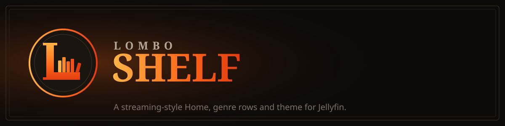

<p align="center"></p>

<p align="center">
  <a href="LICENSE"></a>
  <a href="https://github.com/Lombo-Forge/jellyfin-plugin-lomboshelf/actions/workflows/ci.yml"></a>
  <a href="https://github.com/Lombo-Forge/jellyfin-plugin-lomboshelf/releases"></a>
  
  
  <a href="https://ko-fi.com/datlombardo"></a>
</p>

# LomboShelf

A streaming-style Home for Jellyfin's web client: a Resume card, Keep watching, New this week, one row per genre, genre
chips on the Movies and Shows pages, an optional next-season prompt, and a dark theme whose colours you set.

> **Status: early. It works in one real test, and is not released.** The JavaScript and CSS in [`web/`](web) are tested in jsdom, and the C# plugin in [`plugin/`](plugin) has 166 unit tests. On 2026-11-21 it ran once in a throwaway Jellyfin 12.4.0 with File Transformation 3.0.3.0: both plugins loaded, the registration worked, `index.html` carried the settings and the versioned `loader.js` tag, the asset and settings routes answered as designed (anonymous 401, normal user 403, admin 200, bad input 400), and headless Chromium showed the dark theme, a "New this week" row and a collection row on desktop and phone widths. Everything else is untested, see [what is not verified](#what-is-not-verified). There is no release or plugin repository yet (see [docs/design.md](docs/design.md)).

## Contents

- [What you get](#what-you-get)
- [Try the web files by hand](#try-the-web-files-by-hand)
- [Install in a minute (planned)](#install-in-a-minute-planned)
- [Settings](#settings)
- [What is not verified](#what-is-not-verified)
- [FAQ](#faq)
- [Contributing and licence](#contributing-and-licence)

## What you get

| Piece | What it does |
|---|---|
| Home shelf | Resume, Keep watching, New this week, genre rows. If it fails, Jellyfin's own rows come back. |
| Collection rows | Off by default. Name up to 5 Jellyfin collections (exact name, optional title and item count) and each becomes a Home row, for example a "Leaving soon" collection kept up to date by another tool. LomboShelf does not need that tool. A missing or empty collection shows nothing. |
| Genre browsing | Chips, sort and "Unwatched only" on Movies and Shows. |
| Next-season prompt | Off by default. Asks once whether to request the next season, through Seerr via Jellyfin Enhanced. |
| Header menu | Off by default. Reorder library links, fold some into a drop-down. |
| Storage tags | Off by default. A small SSD or HDD badge on a title's page, read from the `tiers.json` file LomboTier writes. Administrators only unless you change that. |
| Keep button | Off by default. "Leaving in N days" and a "Keep it longer" button for titles in the `leaving.json` file LomboFarewell writes; the server makes the keep call, so the browser never holds Farewell's token. |
| Travel card | Off by default. A small collapsed "Travelling?" card on Home where a signed-in person can allow sign-in from abroad for themselves, through LomboVisa's self-service API; the server makes the call, so the browser never holds Visa's token. |
| Theme | Dark, with colours as settings. Can be switched off. |

Works in the browser and the phone apps that embed Jellyfin's web client. Jellyfin's native apps ignore it.

## Try the web files by hand

On a **throwaway** Jellyfin 12.x, not your real one. Serve the `web/` folder from any static web server on your network, then
add this to the page (for example with a custom-JavaScript plugin you already trust), before the script tag:

```html
<script>window.LomboShelfConfig = { theme: { accent: "#e50914" }, features: { nextSeason: false } };</script>
<script src="http://your-test-host:8080/loader.js"></script>
```

`loader.js` loads `lomboshelf.css` and the other scripts from the same folder. Remove the two lines to go back to stock.

## Install in a minute (planned)

This is how it is meant to work once the plugin is built and released; it does not work today.

1. Install the **File Transformation** plugin.
2. Dashboard, Plugins, Repositories, add the LomboShelf repository URL, then install LomboShelf and restart Jellyfin.
3. Open the plugin's settings and pick your colours and features.

## Settings

The keys are listed in [docs/design.md](docs/design.md#settings). All are optional.

Collection rows: `collectionRows: [{ "name": "Leaving soon", "title": "Going soon", "limit": 20 }]`. `name` must match the
collection exactly; `title` (defaults to the name) and `limit` (1-50, default 16) are optional; at most 5 rows. The list is
empty by default, which means the feature is off. In the plugin's settings page it is a text box with one
`name | title | limit` line per row.

### Storage tags and keep button

Both read files and an API that other Lombo apps own (the formats are in the Lombo hub repository's `docs/contracts.md`).
Both are off until you switch them on in the plugin's settings page, which asks for:

- Storage tags: the full path of `tiers.json` as Jellyfin sees it, and the part of a Jellyfin file path to strip (for
  example `/media/`) so the rest equals the `path` values in that file; "Administrators only" is on by default.
- Keep button: the full path of `leaving.json`, Farewell's address (`http://host:port`, nothing else) and its token. The
  token is saved on the server, shown as a password box, never sent back to the settings page (it says whether one is saved;
  leaving the box empty keeps it) and never put in the page's settings.
- Keep with a name (`KeepSendsName`, off by default): when LomboFarewell limits keeps per person it refuses a keep with no
  name. Turn this on and the server adds the signed-in person's own Jellyfin user name to the keep call (`"by"`). **Turn
  on only with LomboFarewell 0.3.0 or newer; older versions refuse the extra key.** The name is read by the server from the
  verified sign-in, never from the browser, and is not put in any answer, log line or the page's settings.

The server resolves the folder and makes the keep call. The browser only sends the item id with the signed-in person's own
token and never sees a file path. The design and its reasons are in [docs/design.md](docs/design.md#storage-tags-and-the-keep-button).

### Travel card

Off until you switch it on in the plugin's settings page, which asks for LomboVisa's address (`http://host:port`, nothing
else) and its API token (handled like Farewell's: a password box, never sent back, an empty box keeps the saved one). The
server asks Visa for the signed-in person's own window and opens one only for them, for the number of days they pick; Visa
decides the limits and refuses administrator accounts. See [docs/design.md](docs/design.md#the-travel-card) and
[docs/security.md](docs/security.md).

## What is not verified

What has run in a real Jellyfin (2026-11-21, a throwaway Jellyfin 12.4.0 with File Transformation 3.0.3.0, driven by headless Chromium from Playwright 1.49.1, with a three-movie library): both plugins load, File Transformation accepts the registration, `index.html` is transformed with the settings and the versioned `loader.js` tag, the asset route and the settings route answer as designed, and the Home page shows the theme, the "New this week" row and a "Leaving soon" collection row (a real BoxSet found by name and its children listed) at 1280 and 390 pixel widths.

The test is repeatable: `sh test/real-jellyfin/run.sh` builds the plugin, starts a throwaway Jellyfin on `127.0.0.1:18096`, installs File Transformation from its GitHub release into that server only, starts two small fake services (a keep call and a travel call, reachable only from inside that server's own network) and runs the checks and the browser (needs docker, `gh` and python3; never point it at your own server).

Not run, and so unverified:

- `KeepSendsName` (the keep call carrying the person's name): xUnit tests cover it, and the real-Jellyfin harness (104 checks, six clean runs in a row on 2026-11-22) proves it against a fake Farewell: setting off sends exactly `{"title"}`, setting on sends the signed-in person's name from Jellyfin's user manager, a body naming someone else is refused, and the name is in no answer. Never run against a real LomboFarewell 0.3.0 with its per-person limit on, and its settings checkbox was never opened in a browser.
- Storage tags, the keep button and the travel routes: on 2026-11-21 `test/real-jellyfin/run.sh` ran them in a throwaway Jellyfin 12.4.0 against two small fake services (a fake Farewell and a fake Visa) and sample `tiers.json` and `leaving.json` files, with a real admin and a real normal user: 95 checks passed. That proved the plain `[Authorize]` policy and the `Jellyfin-UserId` claim, the library lookup on real items, the tier answers (an administrator gets `ssd` or `hdd`, a normal user gets 204 while 'administrators only' is on), the leaving lookup, the keep and travel calls with their refusals (422) and failures (502), the cool-down, 401 for anonymous, 404 when a feature is off, the token kept out of every answer, and no file path in any answer. (Jellyfin 12.4 has no policy named `DefaultAuthorization`: the first version used it and every new route answered 500. The harness found it.) **Still not run:** where the badge, the note and the Travelling card land on the real details and Home pages (the selectors `.itemName`, `.nameContainer` come from older jellyfin-web, and no screenshot shows them), the settings page's new fields in a browser, and a call to a real LomboFarewell, LomboVisa or real files written by LomboTier.

- The travel card: its routes were proven in the real-Jellyfin run described above, against a fake Visa. Not run: where the card lands on the real Home page, the new settings fields on the real settings page, and a call to a real LomboVisa.

- Genre rows, the "Continue watching" and keep-watching rows (the test library had no genres and no watch history), the next-season prompt (needs Jellyfin Enhanced, not installed), the header menu and the settings page's own screen (the routes behind it were called directly, the page was never opened).
- Real clients: TV layouts and focus, phones and tablets beyond one narrow browser window, other browsers.
- Loading order when LomboShelf starts before File Transformation (in the test File Transformation loaded first), upgrading and uninstalling, other Jellyfin versions, and a large real library.
- Installing from a plugin repository: the release zip, its checksum and the manifest entry were never built or fetched.
- One console error, "Incorrect locale information provided", came from Jellyfin's own `main` bundle in headless Chromium; it was not compared with a run without the plugin.
- The CSS beyond the Home page was not looked at, and there is no CSS linter. JavaScript is checked with ESLint and 34 jsdom tests (`npm test`).

## FAQ

**Will it break my Home?** The shelf only hides Jellyfin's rows after it has drawn itself, and removes itself on any error.

**Does it send data anywhere?** Only to your Jellyfin server. The next-season dialog can show a backdrop from TMDb's image server; set `nextSeason.showArt` to false to avoid that.

**Why a plugin and not the JavaScript Injector?** Fewer moving parts to install and update, and settings in one place. The injector route still works for the web files.

## Contributing and licence

Contribution, security and conduct rules come from the [Lombo-Forge organisation](https://github.com/Lombo-Forge/.github). Licensed under [GPL-3.0](LICENSE) (a Jellyfin plugin links Jellyfin's GPL packages). Credits are in [NOTICE.md](NOTICE.md). Not affiliated with or endorsed by the Jellyfin project.
